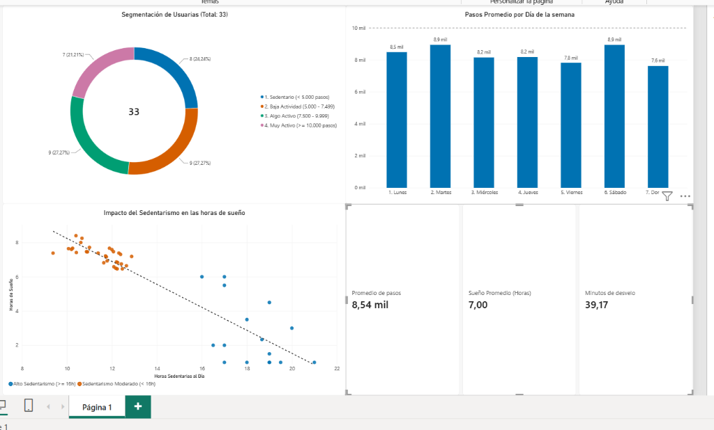
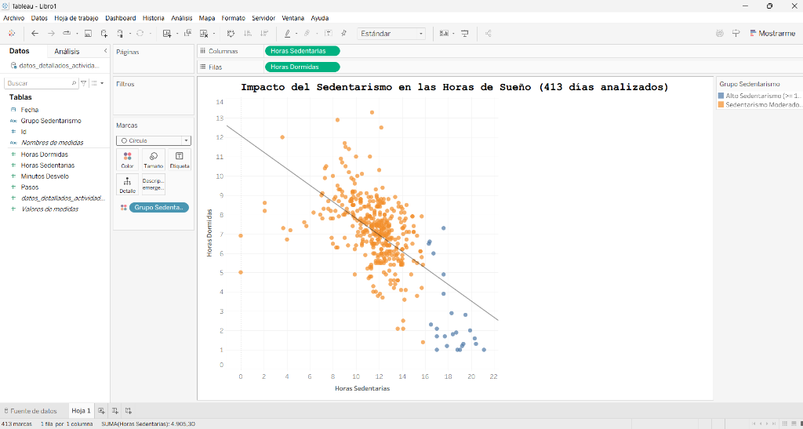

# Caso de Estudio 2: Bellabeat — Análisis de Datos de Bienestar Inteligente
## Estrategia de Marketing Basada en Datos para el Ecosistema Leaf y Bellabeat App
**Google Data Analytics Professional Certificate — Capstone Project (Caso 2)**  
*Autor: Diego Hidalgo | Octubre 2026*  
*Stack Tecnológico: SQL (DuckDB + DBeaver) | R & RStudio (tidyverse, ggplot2) | Power BI Desktop | Tableau Desktop | Python*

---

## 📊 Dashboard Ejecutivo (Power BI)



---

## 1. Resumen Ejecutivo (Executive Summary)

**Bellabeat** es una empresa pionera de tecnología enfocada en la salud y el bienestar femenino, cofundada por **Urška Sršen** y **Sando Mur**. Su catálogo incluye productos de diseño elegante como el monitor inteligente **Leaf** (usable como pulsera, collar o broche) y la **Bellabeat App**.

Para identificar oportunidades de crecimiento frente a competidores gigantes como Fitbit o Apple, este estudio analizó datos de actividad física, sueño y frecuencia horaria de usuarios de monitores inteligentes (*FitBit Fitness Tracker Data*).

### Los 4 Hallazgos Clave de Negocio:
1. **El Rechazo al Monitor de Muñeca Nocturno:** Mientras que el 100% de los usuarios registra su actividad diurna (33 usuarios), el **27,3% abandona el seguimiento del sueño** (solo 24 usuarios lo utilizan). Los relojes inteligentes voluminosos con pantallas brillantes incomodan al dormir. **Oportunidad para Leaf:** al carecer de pantalla y ser liviano como broche de pijama o clip, ofrece una experiencia de descanso sin fricción.
2. **Impacto Negativo del Sedentarismo en el Sueño:** Se descubrió una **fuerte correlación negativa (-0,60)** entre minutos sedentarios diurnos y minutos de sueño nocturno. En días con sedentarismo extremo (>= 16 horas), el sueño efectivo se desploma a solo 2.7 horas promedio.
3. **El "Desvelo Oculto" de 39 Minutos:** En promedio, las personas pasan **7,6 horas en cama pero solo duermen 7,0 horas**. Pasan casi 40 minutos despiertas tratando de conciliar el sueño o al despertar.
4. **Horarios Clave de Actividad y el Bajón de las 15:00 hrs:** La actividad física se concentra en la salida laboral (**17:00 - 19:00 hrs**, con picos de 599 pasos/hora). Por el contrario, a las **15:00 hrs (3 PM)** ocurre la mayor caída de energía y movimiento del horario de oficina (406 pasos/hora).

---

## 📈 Modelo de Dispersión y Regresión (Tableau)



---

## 2. Fase 1: Preguntar (Ask)

### Tarea de Negocio (Business Task)
Analizar las tendencias de uso de dispositivos inteligentes de salud de la competencia para comprender los hábitos diarios de las consumidoras, y aplicar estos hallazgos en una **estrategia de marketing integral que posicione el rastreador Leaf y la Bellabeat App**.

### Preguntas Guía:
1. ¿Cuáles son las principales tendencias de uso en dispositivos de bienestar?
2. ¿Cómo se aplican estas tendencias a las clientas actuales y potenciales de Bellabeat?
3. ¿Cómo pueden estos hallazgos influir en el mensaje y los canales de marketing de Bellabeat?

### Partes Interesadas (Stakeholders)
* **Urška Sršen:** Cofundadora y Directora Creativa de Bellabeat.
* **Sando Mur:** Matemático y Cofundador de Bellabeat.
* **Equipo de Marketing Analytics de Bellabeat.**

---

## 3. Fase 2: Preparar (Prepare)

### Fuente de Datos
* **Dataset:** *FitBit Fitness Tracker Data* (Kaggle - CC0 Dominio Público).
* **Alcance:** 33 usuarios únicos durante 30 días continuos (12 de abril a 12 de mayo de 2016).
* **Archivos utilizados:** `dailyActivity_merged.csv`, `sleepDay_merged.csv`, `hourlySteps_merged.csv`.

### Integridad y Evaluación ROCCC de Google:
* **Reliable (Confiable):** Datos recogidos por Amazon Mechanical Turk; tamaño muestral acotado (33 usuarios).
* **Original (Original):** Fuente secundaria (Fitabase).
* **Comprehensive (Completo):** Contiene métricas por minuto, hora y día de pasos, calorías, intensidades y sueño.
* **Current (Actual):** Datos de 2016 (las tendencias de hábitos de sueño y sedentarismo continúan siendo vigentes).
* **Cited (Citado):** Documentado y utilizado ampliamente como estándar de benchmarking.

---

## 4. Fase 3: Procesar (Process) & Modelado SQL (DuckDB)

Se implementó una base de datos local en **DuckDB** conectada a **DBeaver** para ejecutar SQL analítico sobre los datos.

### Limpieza realizada:
* Eliminación de días sin uso del dispositivo (0 pasos y 1.440 minutos sedentarios).
* Conversión y normalización de formatos de fecha `DATE` y `TIMESTAMP`.
* Cálculo de métricas derivadas: tiempo de desvelo (`TotalTimeInBed - TotalMinutesAsleep`), horas sedentarias (`SedentaryMinutes / 60.0`).

### Consultas SQL Clave:

#### Segmentación de Usuarias con CTE (Subconsulta):
```sql
WITH promedio_por_usuario AS (
    SELECT 
        Id,
        ROUND(AVG(TotalSteps), 0) AS pasos_promedio_diarios
    FROM daily_activity
    GROUP BY Id
)
SELECT 
    CASE 
        WHEN pasos_promedio_diarios < 5000 THEN '1. Sedentario (< 5.000 pasos)'
        WHEN pasos_promedio_diarios BETWEEN 5000 AND 7499 THEN '2. Baja Actividad (5.000 - 7.499)'
        WHEN pasos_promedio_diarios BETWEEN 7500 AND 9999 THEN '3. Algo Activo (7.500 - 9.999)'
        ELSE '4. Muy Activo (>= 10.000 pasos)'
    END AS tipo_usuario,
    COUNT(*) AS cantidad_usuarios,
    ROUND(COUNT(*) * 100.0 / SUM(COUNT(*)) OVER(), 1) AS porcentaje_usuarios,
    ROUND(AVG(pasos_promedio_diarios), 0) AS pasos_grupo
FROM promedio_por_usuario
GROUP BY tipo_usuario
ORDER BY tipo_usuario;
```

---

## 5. Fase 4: Analizar (Analyze) & Resultados

| Métrica Analizada | Valor Obtenido | Interpretación de Negocio |
| :--- | :---: | :--- |
| **Usuarios con Actividad** | 33 | 100% de adopción para registro diurno |
| **Usuarios con Sueño** | 24 | **27.3% de abandono nocturno** (oportunidad Bellabeat Leaf) |
| **Pasos Diarios Promedio** | 8.319 | Por debajo de la recomendación de 10.000 de la OMS |
| **Horas Sedentarias Diarias** | 15.9 hrs | Alerta de sedentarismo en jornada laboral |
| **Horas de Sueño Promedio** | 7.0 hrs | Sueño dentro del rango saludable |
| **Desvelo Promedio en Cama** | 39.2 min | Latencia de inicio de sueño y despertares nocturnos |
| **Pico de Pasos Semanal** | Martes y Sábado | ~8.948 pasos promedio |
| **Valle de Pasos Semanal** | Domingo | 7.627 pasos (día más sedentario) |

---

## 6. Fase 5: Compartir (Share) — Suite de Entregables

1. **Dashboard Ejecutivo en Power BI (`dashboard_bellabeat.pbix`):**
   - Gráfico de anillo interactivo de segmentación de usuarias.
   - Columnas de pasos por día de la semana con meta de 10 mil pasos.
   - Dispersión de sedentarismo vs sueño con línea de regresión.
   - Tarjeta multilínea con KPIs consolidados.
2. **Modelo en Tableau Desktop (`analisis_bellabeat.twbx`):**
   - Gráfico de dispersión con 413 marcas desagregadas y opacidad visual.
3. **Reporte Científico Reproducible en RStudio (`analisis_bellabeat.Rmd` / `.html`):**
   - Flujo reproducible en `tidyverse` y visualizaciones con `ggplot2`.
4. **Informe Ejecutivo en PDF:**
   - [`Informe_Final_Bellabeat.pdf`](Informe_Final_Bellabeat.pdf) listo para presentación directiva.

---

## 7. Fase 6: Actuar (Act) — Recomendaciones Estratégicas para Bellabeat

### Recomendación 1: Campaña "Duerme Ligera, Duerme Mejor" (Posicionamiento Leaf)
* **Insight:** El 27.3% de las personas no tolera dormir con smartwatches tradicionales en la muñeca.
* **Estrategia:** Destacar en anuncios y redes sociales la versatilidad del **Bellabeat Leaf** (usado como broche en el pijama o collar liviano). Al no tener pantalla luminosa ni vibraciones invasivas, garantiza un monitoreo del sueño 100% natural.

### Recomendación 2: Notificaciones Push Preventivas a las 14:45 hrs
* **Insight:** Las 15:00 hrs registra el desplome más severo de movimiento del día (406 pasos/hora).
* **Estrategia:** Configurar alertas amigables en la **Bellabeat App** a las 14:45 hrs proponiendo:
  - Una pausa activa de 5 minutos o caminata corta.
  - Recordatorio de hidratación sincronizado con la botella inteligente **Bellabeat Spring**.

### Recomendación 3: Retos Progresivos de Pasos (Enfoque en el 51.5% Sedentario o de Baja Actividad)
* **Insight:** Más de la mitad de las usuarias camina menos de 7.500 pasos al día. Exigir 10.000 pasos genera frustración.
* **Estrategia:** Diseñar en la app programas escalonados (+500 pasos por semana) con gamificación y recompensas de bienestar, fomentando la adherencia a largo plazo.

### Recomendación 4: Rutinas Nocturnas para Reducir los 39 Minutos de Desvelo
* **Insight:** Las usuarias pasan casi 40 minutos despiertas en cama antes de dormir o tras despertar.
* **Estrategia:** Incluir en la membresía de la app meditaciones guiadas, ejercicios de respiración y sonidos relajantes programados para activarse automáticamente 30 minutos antes de la hora habitual de dormir.

---

## 📂 Estructura del Repositorio

```text
├── dashboard_bellabeat.pbix         # Tablero interactivo en Power BI Desktop
├── analisis_bellabeat.twbx          # Libro empaquetado en Tableau Desktop
├── analisis_bellabeat.Rmd           # Código reproducible en R Markdown
├── analisis_bellabeat.html          # Reporte interactivo generado con RStudio
├── Informe_Final_Bellabeat.pdf      # Informe ejecutivo final en PDF
├── BITACORA_PASO_A_PASO_BELLABEAT.md# Documentación técnica completa de las 6 fases
├── graficos/                        # Visualizaciones en alta resolución y capturas BI
│   ├── dashboard_powerbi.png
│   ├── scatter_tableau.png
│   ├── 1_sedentarismo_vs_sueno.png
│   └── 5_segmentacion_usuarios.png
└── reportes_resumen/                # Tablas agregadas en formato CSV
    ├── segmentacion_usuarios.csv
    ├── pasos_por_dia_semana.csv
    └── datos_detallados_actividad_sueno.csv
```
